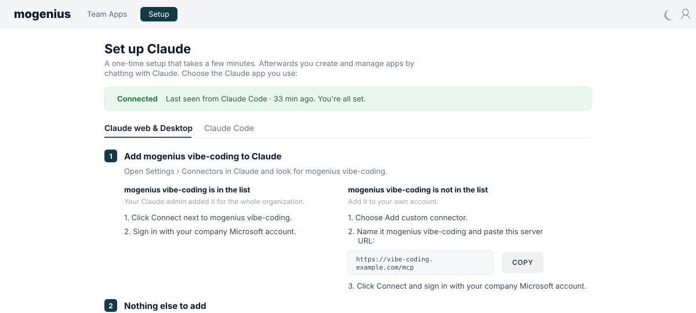

In the Vibe-Coding Platform you build and ship apps by talking to an **AI agent**. The one thing you set up first is the connection between your agent and mogenius. After that, everything is a conversation.

Your agent (for example **Claude**) connects to mogenius and acts as **you** — it can do what your role allows, within your team. It runs under **your own AI account**, so there are no keys to manage.

<Frame caption="Set up Claude — pick your Claude app, add the mogenius vibe-coding connector, and sign in. The banner turns green once your agent is connected.">
  
</Frame>

## Set up Claude

The **Setup** page in mogenius guides you through the connection — a one-time setup that takes a few minutes.

<Steps>
  <Step title="Open Setup and choose your Claude app">
    Go to **Setup** and pick the Claude you use: **Claude web & Desktop** or **Claude Code**.
  </Step>
  <Step title="Add the mogenius vibe-coding connector">
    In Claude, open **Settings → Connectors** and add **mogenius vibe-coding**, using the server URL shown on the Setup page.
  </Step>
  <Step title="Sign in with your company account">
    Click **Connect** and sign in. Claude then acts as you, scoped to your team.
  </Step>
  <Step title="Confirm the connection">
    The Setup page shows a **Connected** banner once your agent has checked in. You're ready to build.
  </Step>
</Steps>

<Note>
On a Claude Team or Enterprise plan, a Claude admin can add **mogenius vibe-coding** once for everyone — then each person only clicks **Connect** and signs in.
</Note>

Next: [Working with your agent](/vibe-coding/working-with-your-agent).
