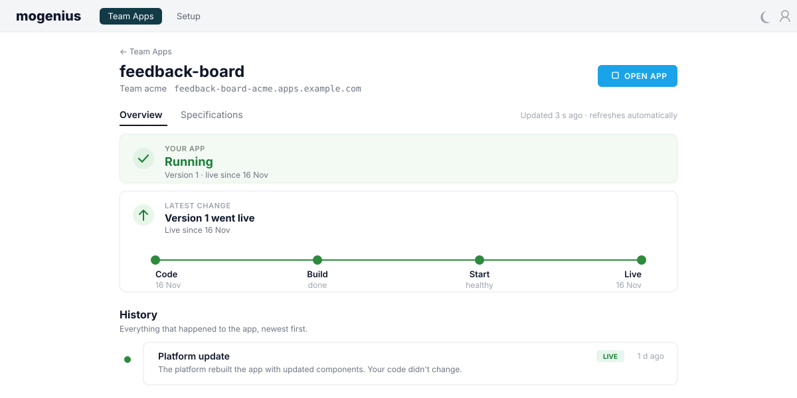

A Vibe Coder describes what they want to an AI agent, and the platform turns that into a running app with its own domain. This page explains what happens in between.

## The workflow

<Steps>
  <Step title="Connect an agent">
    The Vibe Coder connects an AI agent — for example Claude — to mogenius. See [Connect your agent](/vibe-coding/connect-your-agent).
  </Step>
  <Step title="Describe the app">
    They tell the agent what to build and where it belongs — which team, whether it should be reachable from outside, whether it needs a database. The agent asks whatever it needs.
  </Step>
  <Step title="The platform provisions everything">
    From that description, mogenius creates the repository, build pipeline, domain, database, and the security around them — inside the guardrails the Platform Admin set.
  </Step>
  <Step title="Every change ships automatically">
    The agent writes code; each change is built and rolled out. A new version only goes live once it's actually serving, so the current app keeps running until then.
  </Step>
  <Step title="The Vibe Coder watches status">
    In the mogenius UI, they follow the app from **Code** to **Build** to **Start** to **Live**, and get back a domain. See [Your Apps](/vibe-coding/your-apps).
  </Step>
</Steps>

<Frame caption="An app's Overview: the current state, the latest change, and the Code → Build → Start → Live lifecycle the Vibe Coder follows.">
  
</Frame>

## What every app gets

From a single description, the platform provisions the full set an app needs to run safely:

- A **repository** for the app's code
- A **build pipeline** and **container registry**
- A **domain**
- An optional **company login** in front of the app
- An optional **database**
- The **security** around it — isolated networking, resource limits, and backups

Platform Admins see the full list of components; the Vibe Coder just sees a working app. See [Platform components](/vibe-coding/platform-components).

## A lasting abstraction

mogenius models each app as a durable object with its own identity. That identity holds for the app's whole life — it stays an app, instead of dissolving into a pile of Kubernetes resources after the first deploy. That is what makes a citizen-developer experience possible on top of Kubernetes: the Vibe Coder works with their app, never with the machinery underneath.
