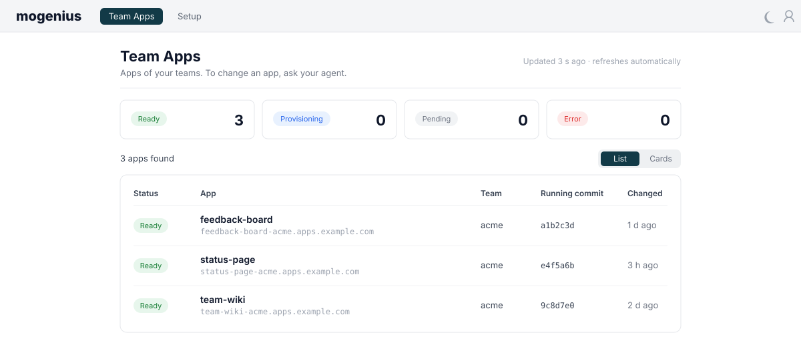

AI lets people who have never written production software build real applications. The hard part is no longer writing the app — it is **getting it online safely**: a repository, a build pipeline, a domain, authentication, a database. On raw Kubernetes that list is a wall, and the platform teams who own the cluster can't hand it to a non-developer.

The **Vibe-Coding Platform** removes that wall. A **Vibe Coder** describes the app they want, and an AI agent builds and ships it. mogenius provisions every component the app needs and runs it on **your own cluster**, inside the guardrails your platform team defines.

<Frame caption="Team Apps — a Vibe Coder's home: every app in their team, its status, and the running commit. To change an app, they ask their agent.">
  
</Frame>

## Who it's for

- **Vibe Coders** — citizen developers who want to put an app online without learning Kubernetes. They describe apps to an AI agent and watch them go live. See [Building Apps](/vibe-coding/connect-your-agent).
- **Platform Admins** — IT, DevOps, and platform engineers who own the cluster. They enable the workflow once and monitor what teams are doing. See [Setup & Administration](/vibe-coding/prerequisites).

## What makes it different

- **You describe, the platform builds.** The Vibe Coder gives a name and a description. Everything an app needs is generated for them.
- **It runs on your infrastructure.** The whole workflow stays on a cluster in your environment, under your security and compliance rules.
- **It's one integrated flow.** Repository, build pipeline, domain, authentication, and database come as a single, opinionated package — nothing to wire together.

## Explore

<CardGroup cols={2}>
  <Card title="How it works" icon="wand-magic-sparkles" href="/vibe-coding/how-it-works">
    From a described idea to a live app with its own domain.
  </Card>
  <Card title="Concepts" icon="book" href="/vibe-coding/concepts">
    App, Team, Vibe Coder, Platform Admin, and the agent.
  </Card>
  <Card title="Setup & Administration" icon="gear" href="/vibe-coding/prerequisites">
    Enable the workflow and connect your services.
  </Card>
  <Card title="Building Apps" icon="rocket" href="/vibe-coding/connect-your-agent">
    Connect your agent and ship your first app.
  </Card>
</CardGroup>
