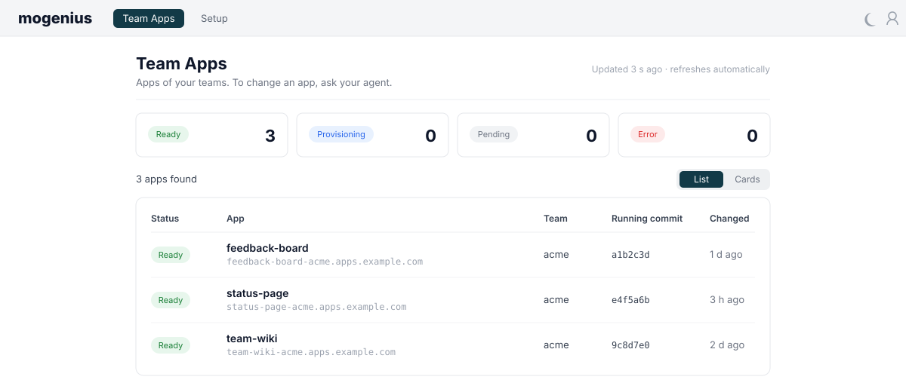
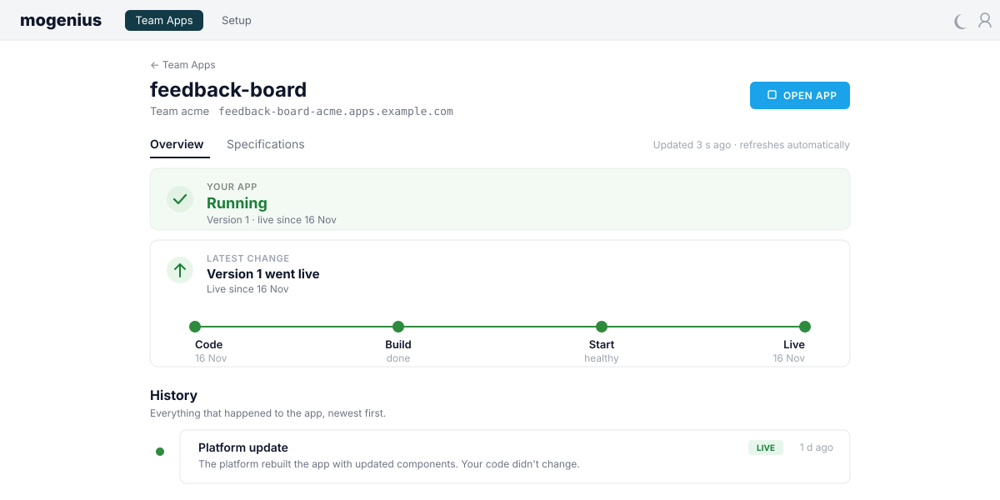

The **Apps** area is where you watch what your agent builds — a list of your team's apps, and a detail page for each.

## My Apps

The apps list shows every app in your team with its current **status** and the commit that's live, plus counter tiles summarizing them at a glance. Open any app to see its details.

<Frame caption="Team Apps — the apps in your team, with status counters and the running commit for each.">
  
</Frame>

## App detail

Each app has a header showing its name, team, and domain, and two tabs.

### Overview

Overview shows where the app is in its lifecycle — **Code → Build → Start → Live** — along with its **domain** and a link to its **repository**. Below that is the app's **history**: the changes behind the app, each with a title, description, and author, so you can see what changed and when.

<Frame caption="The Overview tab: current status, the latest change, the Code → Build → Start → Live stepper, and the app's history.">
  
</Frame>

### Specifications

Specifications describes the app in plain language — what it contains, who can open it, whether it has a database, and its current health — with the technical details available for anyone who helps out.

## Logs

You can view the app's **logs** from its detail page. If something looks wrong, you can also just ask your agent — it reads the same logs and can fix and redeploy.

<Note>
You only see apps of your own team here. Platform Admins have a broader view across all teams for oversight — see [Monitoring](/vibe-coding/monitoring).
</Note>
